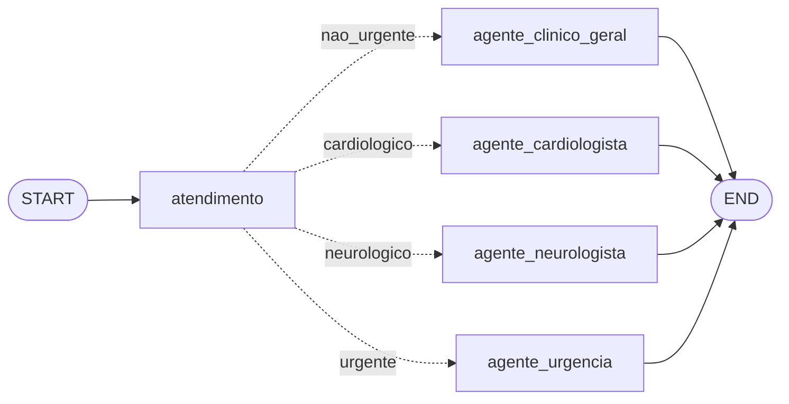

# susia

Sistema multiagente, construído com [LangGraph](https://langchain-ai.github.io/langgraph/), que recebe um prontuário médico e faz a triagem do atendimento.

> Projeto didático. Use apenas prontuários fictícios: ele não substitui avaliação clínica e não deve ser usado com dados reais de pacientes.

## Como funciona

Cada prontuário é encaminhado para o agente certo:

- **não urgente** → agente clínico geral
- **urgente cardiológico** → agente cardiologista
- **urgente neurológico** → agente neurologista
- **urgente geral** → agente de emergência



- **`atendimento`**: lê o prontuário e pede ao modelo uma resposta estruturada com `urgencia`, `especialidade` (`"cardiologia"`, `"neurologia"` ou `"geral"`) e `justificativa`. Na dúvida, o prompt orienta a classificar como urgente.
- **Roteamento** ([src/edges/roteamento.py](src/edges/roteamento.py)): os não urgentes vão para o `agente_clinico_geral`, qualquer que seja a especialidade; os urgentes vão para o `agente_cardiologista` ou o `agente_neurologista`, conforme a especialidade, e os urgentes gerais para o `agente_urgencia`.
- **`agente_clinico_geral`**: agente com tool calling que separa as queixas, consulta o CID-10 com `buscar_cid10` e emite um `parecer_clinico` com hipótese diagnóstica (ou motivo da consulta), condutas e orientações ao paciente.
- **`agente_cardiologista`**: agente com tool calling que separa os sintomas, consulta o CID-10 com `buscar_cid10` e emite um `parecer_cardiologico` com hipótese diagnóstica, risco (`alto`, `moderado` ou `baixo`) e condutas iniciais. Recebe também a classificação de urgência da triagem.
- **`agente_neurologista`**: igual ao cardiologista, com foco neurológico (prioriza códigos G e cerebrovasculares I60 a I69). Emite um `parecer_neurologico` com hipótese diagnóstica, risco e condutas iniciais.
- **`agente_urgencia`**: só roda para prontuários urgentes que não são cardiológicos nem neurológicos. É um agente com tool calling: separa os sintomas e sinais do prontuário, consulta o CID-10 com a ferramenta `buscar_cid10` (uma chamada por sintoma) e devolve `sintomas` e `cids_sugeridos`. O prompt proíbe sugerir código que a ferramenta não devolveu.

### RAG sobre o CID-10

A base de conhecimento é o arquivo `CID-10.pdf`, na raiz do projeto: a lista de categorias de 3 caracteres do CID-10 (versão 2008 do Ministério da Saúde), no formato `código + descrição`.

- Cada categoria vira um documento (2.045 no total); não há divisão por tamanho de texto.
- Na primeira busca, os embeddings são gerados e o índice é salvo em `.cache/cid10_index.json` (cerca de 80 MB, fora do git). Essa primeira vez pode levar alguns minutos, conforme o limite de requisições do deployment. Nas seguintes, o índice é só lido do disco. Para refazer o índice, apague esse arquivo.
- A busca é por similaridade semântica, com `InMemoryVectorStore`.

Limitação: o PDF traz só o nome de cada categoria, sem descrição de sintomas por doença. A busca casa o sintoma com nomes de categorias, e funciona melhor para os códigos do capítulo R (sintomas e sinais).

## State

Definido em [src/state.py](src/state.py):

| Campo | Origem | Descrição |
|---|---|---|
| `paciente_id` | entrada | ID do paciente |
| `prontuario` | entrada | Texto do prontuário médico |
| `data_atualizacao` | entrada | Data da última atualização do prontuário |
| `urgencia` | atendimento | `"urgente"` ou `"nao_urgente"` |
| `especialidade` | atendimento | `"cardiologia"`, `"neurologia"` ou `"geral"` |
| `justificativa` | atendimento | Motivo da classificação |
| `sintomas` | agente que atendeu o caso | Sintomas e sinais separados do prontuário |
| `cids_sugeridos` | agente que atendeu o caso | Lista de `sintoma`, `codigo` e `descricao` do CID-10 |
| `parecer_cardiologico` | agente_cardiologista | `hipotese_diagnostica`, `risco` e `condutas` |
| `parecer_neurologico` | agente_neurologista | `hipotese_diagnostica`, `risco` e `condutas` |
| `parecer_clinico` | agente_clinico_geral | `hipotese_diagnostica`, `condutas` e `orientacoes` |

## Estrutura

```
skill-and-go-ai-agents/
├── CID-10.pdf            # base de conhecimento do RAG
├── langgraph.json        # registra o grafo para o LangGraph Studio
├── requirements.txt
├── .env.example          # modelo das variáveis de ambiente
├── exemplos/
│   ├── prontuarios.json  # prontuários fictícios para testar cada subagente
│   └── criar_dataset.py  # cria o dataset de exemplos no LangSmith
└── src/
    ├── state.py          # state compartilhado entre os nós
    ├── graph.py          # montagem do grafo (exporta `grafo`)
    ├── nodes/
    │   ├── atendimento.py      # agente de triagem
    │   ├── agente_urgencia.py       # agente que separa sintomas e consulta o CID-10
    │   ├── agente_cardiologista.py  # parecer cardiológico com consulta ao CID-10
    │   ├── agente_neurologista.py   # parecer neurológico com consulta ao CID-10
    │   └── agente_clinico_geral.py  # parecer de clínica geral para casos não urgentes
    ├── edges/
    │   └── roteamento.py       # aresta condicional da triagem
    ├── tools/
    │   └── cid10.py            # ferramenta `buscar_cid10`
    └── services/
        ├── llm.py        # clientes do modelo de chat e de embeddings, configurações
        └── cid10.py      # leitura do PDF, índice vetorial e busca
```

`src/services/llm.py` é o único ponto do projeto que conhece o provedor do modelo; os nós só chamam `modelo()`.

## Instalação

Requer Python 3.12 e [uv](https://docs.astral.sh/uv/).

```bash
git clone https://github.com/ernestocid/skill-and-go-ai-agents.git
cd skill-and-go-ai-agents
```

```bash
uv venv --python 3.12
```

```bash
uv pip install -r requirements.txt
```

## Configuração

Copie o modelo e preencha os valores:

```bash
cp .env.example .env
```

Os modelos são acessados pela API v1 do Microsoft Foundry. São usadas quatro variáveis:

| Variável | Valor |
|---|---|
| `AZURE_OPENAI_ENDPOINT` | Endpoint v1 do recurso, terminando em `/openai/v1/`. Exemplo: `https://<recurso>.services.ai.azure.com/openai/v1/` |
| `AZURE_OPENAI_API_KEY` | Chave do recurso |
| `AZURE_OPENAI_CHAT_DEPLOYMENT` | Nome do deployment do modelo de chat no Foundry (nem sempre igual ao nome do modelo) |
| `AZURE_OPENAI_EMBEDDING_DEPLOYMENT` | Nome do deployment de embeddings. Se omitida, vale `text-embedding-3-small` |

Observações:

- O endpoint não deve incluir `/responses` nem `/chat/completions` no final.
- O cliente usa a Responses API, exigida pelos modelos da família gpt-5/codex.
- As demais variáveis do `.env.example` (`AZURE_OPENAI_API_VERSION`, OpenAI, Gemini, Azure AI Search, MLflow) ainda não são usadas pelo código.

## Como rodar

### Pelo Python

```bash
.venv/bin/python -c "from src.graph import grafo; print(grafo.invoke({'paciente_id': 'PAC-001', 'prontuario': 'Homem, 58 anos. Dor toracica em aperto ha 40 min, sudorese, PA 90x60, SpO2 91%.', 'data_atualizacao': '2026-11-15'}))"
```

A saída é o state final, com `urgencia`, `especialidade` e `justificativa` preenchidos. Conforme o ramo, vêm também `sintomas`, `cids_sugeridos` e o parecer do especialista (`parecer_cardiologico`, `parecer_neurologico` ou `parecer_clinico`).

### Pelo LangGraph Studio

```bash
.venv/bin/langgraph dev
```

O comando sobe a API local em `http://127.0.0.1:2024` e abre o Studio no navegador (pede login em uma conta LangSmith). Selecione o grafo `atendimento`, preencha a entrada e clique em **Submit**.

Exemplo de entrada:

```json
{
  "paciente_id": "PAC-004",
  "prontuario": "Mulher, 34 anos. Retorno para renovação de receita de anticoncepcional oral. Sem queixas. PA 110x70 mmHg, FC 72 bpm, afebril.",
  "data_atualizacao": "2026-11-15"
}
```

## Exemplos para testar os subagentes

O arquivo [exemplos/prontuarios.json](exemplos/prontuarios.json) traz 10 prontuários fictícios, com dois a quatro casos por subagente. Cada exemplo tem `inputs` (a entrada do grafo) e `outputs` (a triagem esperada e o agente que deve atender o caso).

| ID | Caso | Triagem esperada | Agente |
|---|---|---|---|
| PAC-101 | Dor torácica irradiando para o braço, sudorese | urgente, cardiologia | `agente_cardiologista` |
| PAC-102 | Palpitações súbitas, FC 165 irregular | urgente, cardiologia | `agente_cardiologista` |
| PAC-103 | Fraqueza súbita à esquerda, fala arrastada (sinais de AVC) | urgente, neurologia | `agente_neurologista` |
| PAC-104 | Cefaleia súbita, "a pior da vida", rigidez de nuca | urgente, neurologia | `agente_neurologista` |
| PAC-105 | Reação alérgica grave após ingerir amendoim | urgente, geral | `agente_urgencia` |
| PAC-106 | Cetoacidose diabética, glicemia 480 mg/dL | urgente, geral | `agente_urgencia` |
| PAC-107 | Resfriado há 4 dias, sem falta de ar | não urgente, geral | `agente_clinico_geral` |
| PAC-108 | Retorno de rotina para controle da pressão | não urgente, cardiologia ou geral | `agente_clinico_geral` |
| PAC-109 | Enxaqueca antiga, no padrão habitual | não urgente, neurologia | `agente_clinico_geral` |
| PAC-110 | Renovação de receita de metformina | não urgente, geral | `agente_clinico_geral` |

PAC-108 e PAC-109 testam a regra de que todo caso não urgente vai para o clínico geral, mesmo quando a queixa é de uma especialidade. No PAC-108, a triagem pode classificar a especialidade como `cardiologia` ou `geral`; o agente é o mesmo nos dois casos.

### No LangGraph Studio

Copie o campo `inputs` de um exemplo e cole como entrada do grafo `atendimento`. Por exemplo, para o neurologista:

```json
{
  "paciente_id": "PAC-103",
  "prontuario": "Homem, 55 anos. Há 40 minutos iniciou fraqueza súbita no braço e na perna esquerdos, fala arrastada e desvio de rima labial. PA 190x105 mmHg, glicemia capilar 128 mg/dL.",
  "data_atualizacao": "2026-11-23"
}
```

Para o clínico geral, com uma queixa neurológica não urgente:

```json
{
  "paciente_id": "PAC-109",
  "prontuario": "Mulher, 29 anos. Enxaqueca há 10 anos, com cerca de 2 crises por mês no padrão habitual, que melhoram com analgésico. Sem sinais de alarme. Exame neurológico normal.",
  "data_atualizacao": "2026-11-23"
}
```

Os campos `urgencia` e `especialidade` são preenchidos pela triagem: não os inclua na entrada.

### Como experimento no LangSmith

O script [exemplos/criar_dataset.py](exemplos/criar_dataset.py) cria o dataset `susia-triagem` com os 10 exemplos:

```bash
export LANGSMITH_API_KEY=<sua chave>
.venv/bin/python exemplos/criar_dataset.py
```

Depois, no Studio, escolha o dataset e rode o experimento. As entradas de um dataset precisam ter `paciente_id`, `prontuario` e `data_atualizacao` no primeiro nível, sem aninhar em outro campo; senão a validação do `State` falha antes do primeiro nó.

Observação: o filtro de conteúdo do Azure OpenAI pode recusar prontuários com descrições explícitas de trauma ou sangramento (HTTP 400, "content management policy").

## Visualizar o grafo

```bash
.venv/bin/python -c "from src.graph import grafo; print(grafo.get_graph().draw_mermaid())"
```

O comando imprime o diagrama em Mermaid, que pode ser colado em qualquer visualizador Mermaid.
